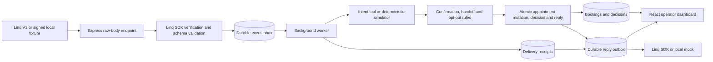

# Linq Appointment Concierge

Customers can text a service business to check availability, book, reschedule, or cancel. Specific proposals require confirmation. The operator inbox shows the conversation, appointments, decision reasons, traces, and delivery status.

## Local setup

Use Node.js 24.14 or later.

```sh
npm ci
npm run dev
```

Open http://127.0.0.1:3000. Pick Maya, enter **Book Friday at 10 AM** or another upcoming weekday, and send **Yes** after the proposal appears. Use the demo with zero API credentials. Defaults persist to `data/demo.sqlite`. Copy `.env.example` to `.env` to customize settings. Set `DB_PATH` to a new file for a clean demo.

```sh
npm test
npm run build
npm start
```

The last two commands build and serve the dashboard. Both application modes listen on loopback.

## Architecture



- The webhook uses the SDK to verify the original body and validates the fields it consumes for webhook version `2026-02-03`. It acknowledges after a durable insert. Event ID and inbound message ID both deduplicate.
- The classifier emits one intent. Application functions retrieve appointments, check slots and apply changes. Proposals expire after 15 minutes. Confirmation rechecks the proposal send state, appointment revision and slot availability. A SQLite transaction commits the booking write, decision, outbox row and inbox completion together. A unique index enforces one active reservation per slot.
- The outbox caps transient failures at four attempts, honors `Retry-After`, and reuses one persisted message idempotency key. Receipts correlate by chat and provider message ID, even when they arrive ahead of the API response. The log carries correlation IDs and Linq trace IDs without message bodies or credentials. SMS can remain at `sent` because it lacks delivered/read receipts. [Linq webhook events](https://docs.linqapp.com/channel/imessage/guides/webhooks/events/)
- `STOP` clears proposals and suppresses queued replies for the sender. `START` restores eligibility. Human requests pause automation for that chat. Operators follow up in their messaging inbox and can resume automation from the dashboard. An in-flight send may finish if a later opt-out arrives.
- The demo uses one process, SQLite, one staff calendar, one upcoming booking per conversation and 30-minute slots from 9 AM to 5 PM Central on weekdays. Slots are stored in UTC. Unclear dates or times prompt a clarification. A reschedule phrased as “move it to Monday at 2” can infer PM when only one interpretation falls inside business hours. The displayed offer always includes the exact time. A hosted deployment would need operator authentication, retention rules and worker coordination.

## Verification and status

| Area | Evidence |
| --- | --- |
| Local app | Signed HTTP fixtures exercised Express, the installed signature verifier, the SQLite worker, and the dashboard API. The same flow works with the demo fixture sender. |
| Automated tests | 14 passed. Coverage includes invalid and stale signatures, duplicates, ambiguous dates, DST, booking and reschedule confirmation, concurrent slot competition, opt-out, human handoff, retries, delivery reconciliation and recovery across a database reopen. |
| Linq adapter | The installed SDK ran with injected HTTP responses to verify its request path, timeout, rate-limit handling, stable idempotency keys, allowlist and trace capture. |
| Simulated | Local customer messages use fixture handles. Local replies are labeled `simulated`. The optional OpenAI classifier was tested with injected tool responses and failures. |
| Live verification pending | Test token authorization, sandbox webhook delivery and headers, real API sends, provider-side deduplication and delivery receipts. No external messages or paid requests were made during development. |

The TypeScript and Vite production build passed. Node 24 emitted its experimental SQLite notice.

## Approved Linq sandbox test

1. Obtain explicit approval for an actual message and any public ingress. Obtain a sandbox token, a sandbox-owned line, the signing secret and a consenting E.164 test recipient. Verify the sandbox account in Linq because the app cannot infer credential scope.
2. Set `MESSAGING_MODE=linq-sandbox`, `APPROVE_LINQ_SANDBOX_SEND=yes`, the token, signing secret, sender line and allowlisted recipient from `.env.example`. Keep `INTENT_MODE=local` for this check. Sandbox mode uses its own database by default.
3. With ingress separately approved, forward only `POST /webhooks/linq` from controlled HTTPS ingress. Preserve raw body bytes and signing headers, and use a localhost Host upstream. Pin `?version=2026-02-03` on the subscription target. Subscribe to `message.received`, `message.sent`, `message.delivered`, `message.read` and `message.failed`. [Webhook setup](https://docs.linqapp.com/channel/imessage/guides/webhooks/)
4. Send a test booking request into the sandbox line, confirm it from the allowlisted recipient, and compare the dashboard’s IDs with the Linq event and send traces. Verify redelivery behavior and receipt transitions for the tested messaging protocol.

The optional remote classifier uses OpenAI Chat Completions function calling. Enable it only after approval with `INTENT_MODE=openai`, `APPROVE_REMOTE_LLM=yes`, `OPENAI_API_KEY` and a tool-capable `OPENAI_MODEL`. It falls back locally on provider failure, timeout or invalid tool output.

[Two-minute demo script](DEMO.md) · [Developer experience notes](DEVEX_NOTES.md)